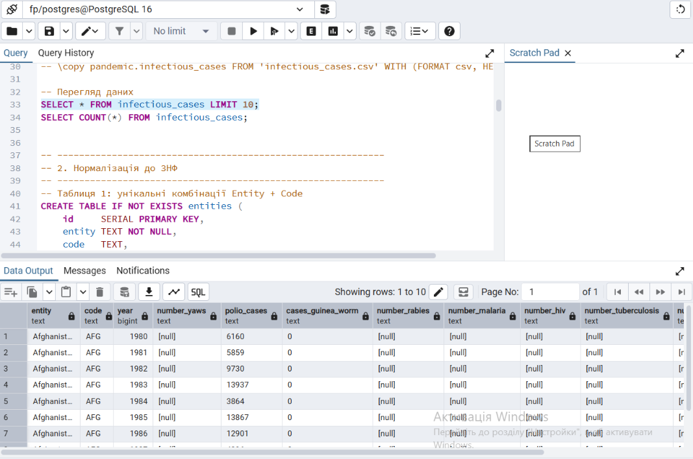
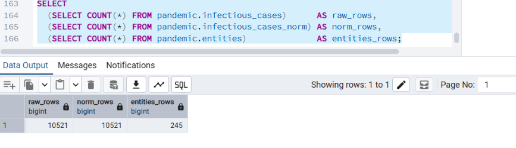
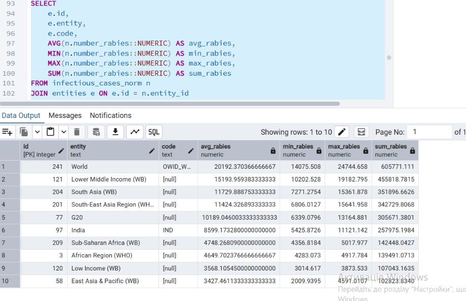
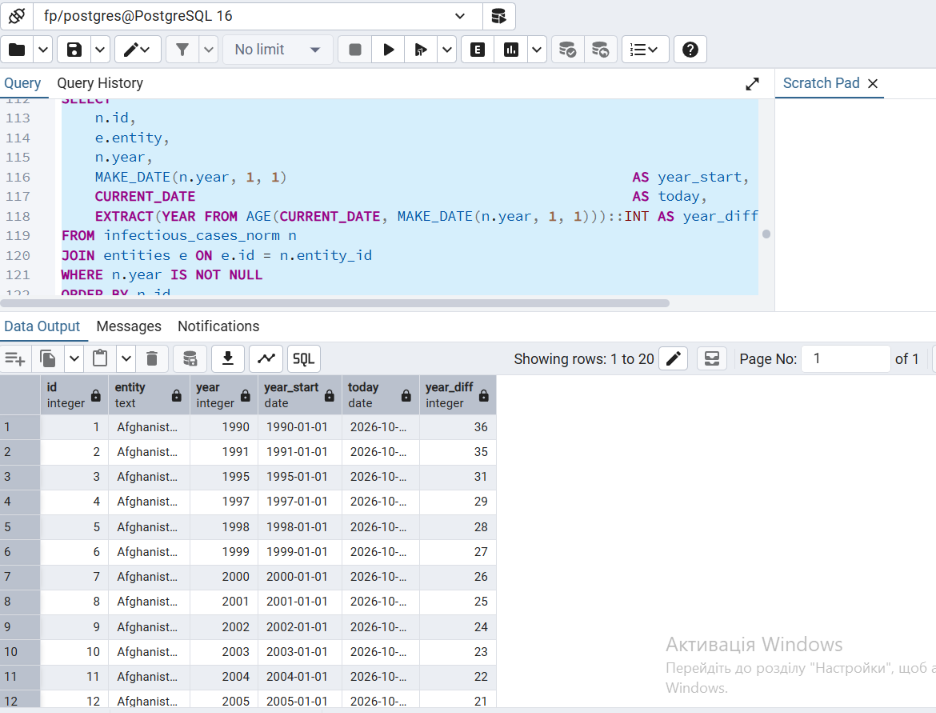
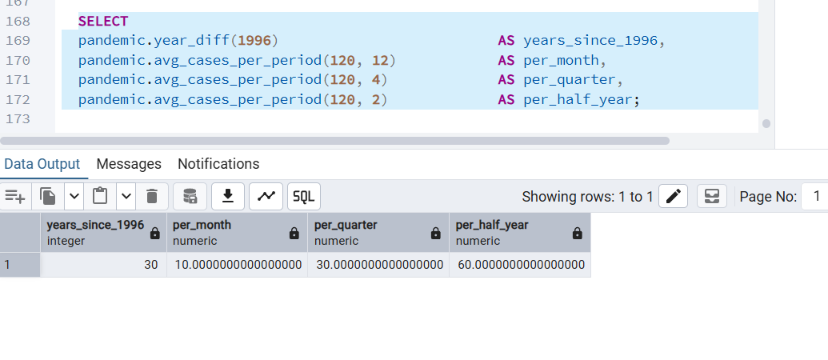

# Фінальний проєкт: infectious_cases (PostgreSQL)

Робота з датасетом `infectious_cases` (статистика інфекційних захворювань за країнами та роками) у PostgreSQL 16.

## Файли

- [`final_project.sql`](final_project.sql): весь SQL-код (завдання 1-5).
- [`FP_Hrysiuk.ipynb`](FP_Hrysiuk.ipynb): той самий код у Jupyter notebook; запускається на локальному PostgreSQL (база `fp`, схема `pandemic`), CSV береться з `C:\Users\PC\Downloads\infectious_cases.csv` або зі змінної `INFECTIOUS_CSV`; пароль вводиться вручну або береться зі змінної `FP_DB_URL`.

## Виконання

1. **Завантаження даних.** Створено схему `pandemic`, вона обрана за замовчуванням (`SET search_path TO pandemic`). Дані з `infectious_cases.csv` імпортуються у таблицю `infectious_cases`. Показники зберігаються як `TEXT`, бо в CSV є порожні значення. Структура перевіряється через `SELECT * ... LIMIT`.
2. **Нормалізація до 3НФ.** Дві таблиці:
   - `entities (id, entity, code)`: унікальні комбінації Entity та Code;
   - `infectious_cases_norm`: показники захворювань, де замість Entity та Code використано `entity_id` (зовнішній ключ на `entities.id`).
3. **Аналіз `Number_rabies`.** Для кожної комбінації Entity + Code рахуються AVG, MIN, MAX, SUM лише за числовими значеннями; результат відсортовано за середнім за спаданням, виведено 10 рядків.
4. **Різниця в роках.** Колонки: дата 1 січня року (`MAKE_DATE`), поточна дата (`CURRENT_DATE`), різниця в роках (`AGE` + `EXTRACT`).
5. **Власні функції.**
   - `year_diff(year)`: різниця в роках між поточною датою та 1 січня вказаного року;
   - `avg_cases_per_period(cases, divisor)`: середня кількість захворювань за період; дільники 12 (місяць), 4 (квартал), 2 (півріччя).

   Обидві функції використано в одному запиті; для другої беруться лише записи з числовим значенням.

## Скріншоти результатів (pgAdmin, база `fp`, схема `pandemic`)

### 1. Завантаження даних
Таблиця `infectious_cases`: 10 521 рядок, показники збережено як `TEXT`.

### 2. Нормалізація до 3НФ
Кількість рядків: сира таблиця 10 521, `infectious_cases_norm` 10 521, `entities` 245. Рядки не втрачено.

### 3. Аналіз `Number_rabies`
Топ-10 за середнім значенням. У топі переважно не країни, а агрегати з датасету (`World`, групи за рівнем доходу, регіони), у них `code` порожній (NULL).

### 4. Різниця в роках
Колонки: 1 січня року, поточна дата, різниця в роках.

### 5. Власні функції
`year_diff(year)` і `avg_cases_per_period(cases, divisor)` з дільниками 12, 4 і 2.

## Як запустити

1. PostgreSQL 16 (pgAdmin): створити порожню базу `fp`.
2. `pip install jupyter psycopg2-binary sqlalchemy pandas`
3. Покласти `infectious_cases.csv` у `C:\Users\PC\Downloads\` (або задати шлях змінною `INFECTIOUS_CSV`).
4. Відкрити `FP_Hrysiuk.ipynb` і виконати Restart & Run All.
